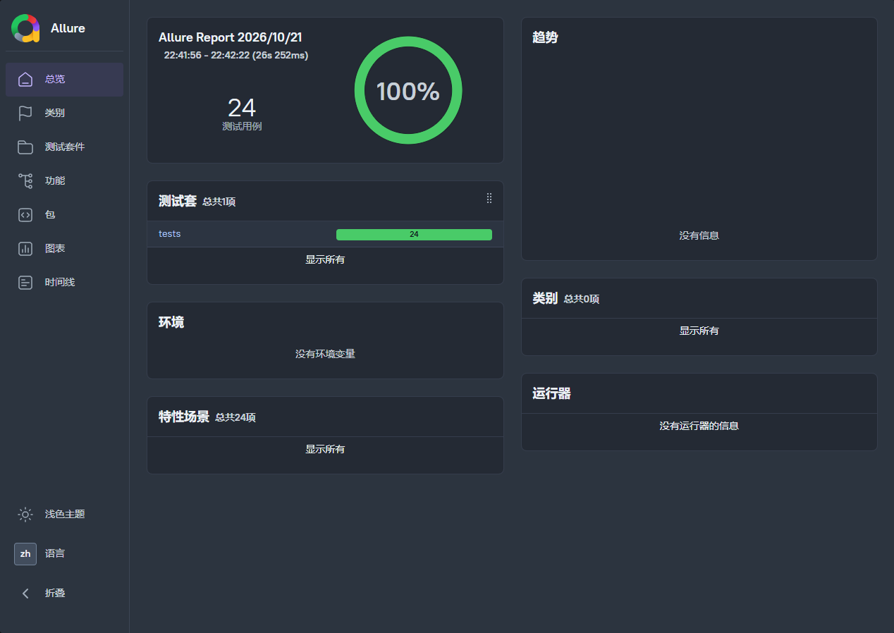

# LLM API 自动化测试练习
基于pytest实现大模型API自动化测试项目，用于验证LLM基础能力、边界输入、安全能力。

## 技术栈
- Python 3.10
- pytest
- openai SDK
- PyYAML
- Allure-pytest（测试报告）

## 项目结构
```bash
llm-test-v1
├── config/                  # 配置目录，存放 API 密钥
│   ├── config.example.yaml  # 配置模板（可提交 git，仅模板，不含真实密钥）
│   └── config.yaml          # 本地私有密钥文件，.gitignore 忽略，不上传 git
├── logs/                    # 自动生成，存放运行日志与失败报文，.gitignore 忽略
│   ├── fail_payload/        # 保存测试失败时的完整 payload json 报文
│   ├── llm_client.log       # LLM 业务调用日志
│   └── test_run.log         # pytest 测试执行日志
├── doc/                     # 项目文档、截图（Allure报告截图存放于此，可提交git）
│   └── allure_report.png
├── utils/                   # 公共工具函数
│   └── llm_client.py        # LLM 客户端封装
├── tests/                   # pytest 测试用例集合
│   ├── conftest.py          # pytest 全局钩子、日志、失败报文保存逻辑
│   ├── test_llm_basic.py            # 基础冒烟用例
│   ├── test_api_response.py          # API 返回结构校验
│   ├── test_prompt_boundary.py       # Prompt 边界值测试
│   ├── test_prompt_equivalence.py    # 等价类 prompt 测试
│   └── test_full_flow.py             # 完整业务流程测试
├── allure-results/          # allure原始测试json数据，运行自动生成，.gitignore忽略
├── allure-report/           # allure网页报告产物，运行自动生成，.gitignore忽略
├── requirements.txt
└── .gitignore
```

> 重要提示：`allure-results/`、`allure-report/`、`logs/`、`config/config.yaml` 均配置在 `.gitignore`，不会提交到远端仓库；`doc/allure_report.png` 为手动保存的报告截图，用于项目展示，可以提交 git。

## 环境安装
建议先创建并激活 Python 虚拟环境，再安装 Python 依赖
```powershell
conda activate ai_qa
pip install -r requirements.txt
```

### Allure 环境安装说明
> Allure 分为两部分：
> 1. `allure-pytest`：Python 插件，已经包含在 `requirements.txt`，负责采集用例执行产出原始 json 数据；
> 2. **Allure 命令行工具（独立程序，需要手动安装，底层依赖 JDK8+）**：读取原始 json，生成可视化 HTML 网页报告，不属于 Python 包。

#### Windows Allure 命令行手动安装步骤
1. 前置条件：本地安装 JDK8 及以上版本，配置 `JAVA_HOME` 环境变量；
2. 下载 allure-commandline 压缩包：https://github.com/allure-framework/allure2/releases
3. 解压到**无中文、无空格路径**，例如 `D:\tools\allure-2.46.1`；
4. 将解压目录内 `bin` 文件夹添加到系统环境变量 `PATH`；
5. **完全关闭所有终端，重新打开终端验证**：
```powershell
allure --version
```
输出版本号代表命令行工具安装成功。

> 注意：采集测试数据需要在 conda 虚拟环境；执行 `allure generate / allure open` 生成网页报告**不需要虚拟环境**。

## 执行测试
> 推荐统一使用 `python -m pytest` 写法，规避 Windows 下 pytest 环境错乱问题。

常规执行，只在失败时输出控制台信息
`-v`：verbose，展示每条用例执行结果
```powershell
python -m pytest tests/ -v
```

调试模式：终端实时打印日志，方便开发排查问题
`-s`：stdout，开启控制台标准输出
```powershell
python -m pytest tests/ -v -s
```

## 测试覆盖范围
1. **基础冒烟测试**：验证大模型正常返回、基础问答、安全内容拒绝
2. **API返回校验**：真实请求校验正常返回值类型；mock 模拟空 choices 场景、服务 500 异常场景，验证异常捕获逻辑，mock 用例无需联网、不消耗 token
3. **边界用例**：参数化校验 Prompt 长度边界，覆盖最短有效输入、上限临界值、超限场景；验证超长 prompt 会触发参数校验异常
4. **等价类测试**：采用参数化，划分有效、无效等价类。有效类包含普通中文、特殊字符 + emoji；无效类覆盖空串、None、纯空白字符串、超长文本，校验输入合法性判断逻辑。
5. **全流程端到端测试（test_full_flow.py）**
    - 单轮链路：配置加载、prompt预处理、API调用、返回断言，验证完整单次调用链路；
    - 多轮对话：连续多轮交互，验证LLM上下文记忆能力，检验模型能否记住前文对话信息。

## Allure测试报告
### 1、生成原始结果（需要激活虚拟环境）
```powershell
# allure-results：存放测试原始结果 json，不会自动生成网页
python -m pytest tests/ -v --alluredir allure-results --clean-alluredir
```

### 2、本地生成并打开网页报告（不需要 conda 虚拟环境）
```powershell
allure generate allure-results -o allure-report --clean
allure open allure-report
```

报告截图：

