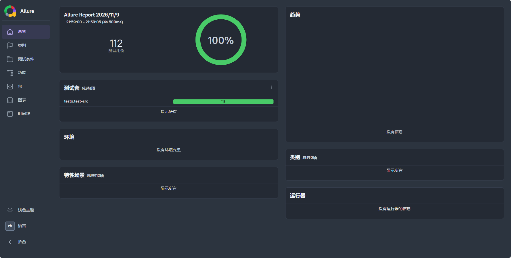

# LLM API 自动化测试练习
基于pytest实现大模型API自动化测试项目，用于验证LLM基础能力、边界输入、安全能力。

## 技术栈
- Python 3.10
- pytest
- openai SDK
- PyYAML
- pytest-mock（mock 模拟接口调用，无需真实网络请求）
- tenacity（chat 接口重试机制）
- Allure-pytest（测试报告）

## 项目结构
```bash
llm-test-v1
├── config/                  # 只放配置文件。密钥在根目录 .env
│   └── config.yaml          # 本地配置：地址、模型、超时等
├── logs/                    # 自动生成，存放运行日志与失败报文，.gitignore 忽略
│   ├── fail_payload/        # 保存测试失败时的完整 payload json 报文
│   ├── llm_client.log       # LLM 业务调用日志
│   └── test_run.log         # pytest 测试执行日志
├── doc/                     # 项目文档、截图（Allure报告截图存放于此，可提交git）
│   ├── allure_report.png
│   ├── LLM_API客户端chat接口测试用例.md
│   └── LLM_API客户端测试计划.md
├── src/                     # 被测源码
│   ├── __init__.py
│   └── llm_client.py        # LLM 客户端封装（LLMClient 类：chat 等能力封装，含重试装饰器）
├── utils/                   # 公共工具，不放被测对象
│   ├── config_loader.py     # 读取 config.yaml，并从 .env 取 API 密钥
│   └── log_helper.py        # 日志辅助模块：logger、handler 统一创建与配置
├── tests/                   # pytest 测试用例集合
│   ├── conftest.py                  # pytest 全局钩子、logger fixture、llm_client 实例 fixture、失败报文保存逻辑
│   └── test-src/                    # 与 src/ 对应的测试目录
│       ├── test_prompt_validation.py    # Prompt / messages 输入校验
│       ├── test_request_passthrough.py  # 单轮、多轮请求组装与参数透传
│       ├── test_retry_and_errors.py     # 重试间隔、次数、预算与不重试
│       ├── test_response_parsing.py     # 服务端响应解析
│       └── test_real_api_smoke.py       # 真实 API 冒烟
├── pytest.ini               # pytest 配置：marker 注册、addopts、搜索规则
├── allure-results/          # allure原始测试json数据，运行自动生成，.gitignore忽略
├── allure-report/           # allure网页报告产物，运行自动生成，.gitignore忽略
├── requirements.txt
└── .gitignore
```

> 重要提示：`allure-results/`、`allure-report/`、`logs/`、`.env` 均配置在 `.gitignore`，不会提交到远端仓库。API 密钥只放在 `.env`，`config/config.yaml` 只放地址、模型和超时等非密钥配置。`doc/allure_report.png` 为手动保存的报告截图，用于项目展示，可以提交 git。

## 环境安装
建议先创建并激活 Python 虚拟环境，再安装 Python 依赖
```powershell
conda activate ai_qa
pip install -r requirements.txt
```

### Allure 环境安装说明
> Allure 分为两部分：
> 1. `allure-pytest`：Python 插件，已经包含在 `requirements.txt`，负责采集用例执行产出原始 json 数据；
> 2. **Allure 命令行工具（独立程序，需要手动安装，底层依赖 JDK8+）**：读取原始 json，生成可视化 HTML 网页报告，不属于 Python 包。

#### Windows Allure 命令行手动安装步骤
1. 前置条件：本地安装 JDK8 及以上版本，配置 `JAVA_HOME` 环境变量；
2. 下载 allure-commandline 压缩包：https://github.com/allure-framework/allure2/releases
3. 解压到**无中文、无空格路径**，例如 `D:\tools\allure-2.46.1`；
4. 将解压目录内 `bin` 文件夹添加到系统环境变量 `PATH`；
5. **完全关闭所有终端，重新打开终端验证**：
```powershell
allure --version
```
输出版本号代表命令行工具安装成功。

> 注意：采集测试数据需要在 conda 虚拟环境；执行 `allure generate / allure open` 生成网页报告**不需要虚拟环境**。

## 执行测试
> 推荐统一使用 `python -m pytest` 写法，规避 Windows 下 pytest 环境错乱问题。

常规执行，只在失败时输出控制台信息
`-v`：verbose，展示每条用例执行结果
```powershell
python -m pytest tests/ -v
```

调试模式：终端实时打印日志，方便开发排查问题
`-s`：stdout，开启控制台标准输出
```powershell
python -m pytest tests/ -v -s
```

按标记筛选执行（结合 `-m` 参数）：
```powershell
# 只执行 mock 用例（不联网、不消耗 token）
python -m pytest -v -m mock

# 只执行真实 API 用例（会消耗 token）
python -m pytest -v -m real_api
```

## 测试标记体系（pytest.ini 已注册）
所有测试用例按是否使用 mock 统一打标签，便于分类执行与报告归集：

| 标记 | 含义 |
| ---- | ---- |
| `mock` | 使用 mocker 补丁模拟调用 API 接口，非真实网络请求，不消耗 token |
| `real_api` | 真实调用 LLM 接口，会产生 token 消耗 |

## 测试覆盖范围
1. **基础冒烟测试**：验证大模型正常返回、基础问答、安全内容拒绝
2. **API返回校验**：真实请求校验正常返回值类型；mock 模拟空 choices 场景、服务 500 异常场景，验证异常捕获逻辑，mock 用例无需联网、不消耗 token
3. **边界用例**：参数化校验 Prompt 长度边界，覆盖最短有效输入、上限临界值、超限场景；验证超长 prompt 会触发参数校验异常
4. **等价类测试**：采用参数化，划分有效、无效等价类。有效类包含普通中文、特殊字符 + emoji；无效类覆盖空串、None、纯空白字符串、超长文本，校验输入合法性判断逻辑。
5. **真实 API 冒烟（tests/test-src/test_real_api_smoke.py）**
    - 真实密钥透传、单轮问答、有害提问拒绝、JSON 输出、超短超时。
6. **Mock 模拟测试**
    - 输入校验、请求透传、异常不重试、响应解析，基于 `pytest-mock`，不联网、不消耗 token。
7. **重试逻辑测试**
    - 429 带可解析的 Retry-After、500 的临时故障码会重试，最多 3 次，并受 25 秒预算约束。502/504 走抖动，503 优先用 Retry-After。连接重试只认 APIConnectionError 本身；APITimeoutError 和 DNS 失败不重试。

## Allure测试报告
### 1、生成原始结果（需要激活虚拟环境）
```powershell
# allure-results：存放测试原始结果 json，不会自动生成网页
python -m pytest tests/ -v --alluredir allure-results --clean-alluredir
```

### 2、本地生成并打开网页报告（不需要 conda 虚拟环境）
```powershell
allure generate allure-results -o allure-report --clean
allure open allure-report
```

报告截图：

